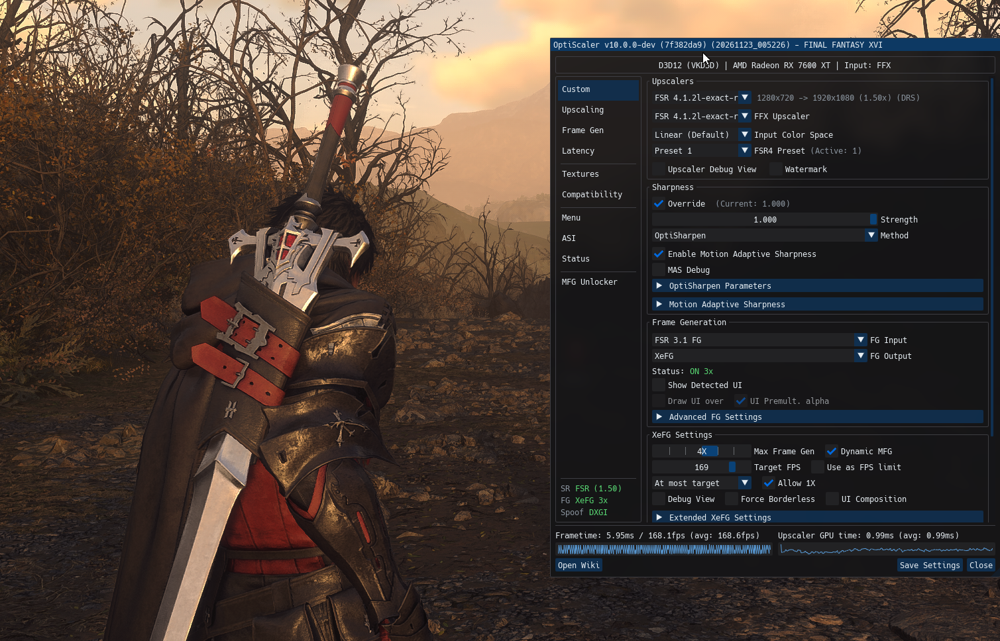

# xemfg-helper

Installs and maintains XeMFG (Intel's XeSS multi frame generation, unlocked for AMD and other GPUs by
MFG Unlocker) through OptiScaler, for Windows games running under Proton. It finds your Steam and Faugus
Launcher games itself, sets everything up in one step and keeps it up to date.

<p align="center">
  
  <br>
  <em>Final Fantasy XVI under Proton on an RX 7600 XT: XeMFG with Dynamic MFG, set up through OptiScaler.</em>
</p>

## What it does

- Finds your Steam and Faugus Launcher games and tells you which ones can use XeMFG.
- Installs into one game, or every game with built-in FSR frame generation at once.
- Uses the newest official FSR4 DLL for your GPU, and lets you switch at any time.
- Updates each part on its own, with pinning, rollback and full removal.
- Verifies downloads, previews changes, backs up replaced files and repairs broken installs, from a terminal UI or command line.

## Before you install

- **What it changes.** It adds files next to the game's exe, backs up anything it replaces and sets a launch option. See [How it works](#how-it-works).
- **Anti-cheat.** OptiScaler changes game files. xemfg refuses games with anti-cheat. `--allow-anticheat`
  overrides that, for offline single-player only: anti-cheat can ban accounts for it.
- **These are unofficial mods.** MFG Unlocker, dashdogy's OptiScaler build and cyboman's DLLs are community
  projects. If a game misbehaves, `xemfg rollback` or `xemfg uninstall` returns it to how it was.

## Install

### Arch / CachyOS

```sh
sudo pacman -S --needed git base-devel
git clone https://github.com/DaveJV/xemfg-helper.git
cd xemfg-helper/packaging/arch
makepkg -si
```

`makepkg -si` installs the Python packages xemfg needs. Run it as your normal user, not root.

### Debian 12 and 13, Ubuntu 24.04 and newer

```sh
sudo apt install pipx git libarchive-tools
pipx install git+https://github.com/DaveJV/xemfg-helper.git
pipx ensurepath
```

Open a new terminal afterwards. Ubuntu 22.04 and Debian 11 are too old (Python 3.10 and 3.9).

### Dependencies

Required:

- Python 3.11 or newer
- Python packages: typer, textual, rich, pefile, rapidfuzz, httpx, tomli-w
- `bsdtar` (libarchive) or 7-Zip, to unpack downloads

Optional:

- GitHub CLI (`gh`), signed in: avoids GitHub's rate limit for anonymous API requests

## Usage

### Quick start

```bash
xemfg
```

Opens the terminal UI, the easiest way to set up and manage your games.

### Command line

You can also run everything directly. Games can be given by title, short name or Steam appid. The examples use `ff16`, short for Final Fantasy XVI.

**Install**

```bash
xemfg scan           # find your games and check compatibility
xemfg install ff16   # install XeMFG and choose an FSR4 DLL
```

**Stay up to date**

```bash
xemfg list           # show installed games and their health
xemfg check          # compare installed and latest versions
xemfg update --all   # update everything that isn't pinned
```

**FSR4 DLLs**

```bash
xemfg fsr4 list ff16                # show DLLs available for this game
xemfg fsr4 set ff16 cyboman:exact   # switch to a different DLL
```

**Fix or remove**

```bash
xemfg doctor           # check all installs for problems
xemfg rollback ff16    # restore the previous version
xemfg uninstall ff16   # remove XeMFG from a game
```

Run `xemfg --help` for the full command list.

## How it works

1. **Finds the game** in Steam, Faugus Launcher, or a folder you add, and works out which exe it runs.
2. **Checks compatibility.** The game needs DirectX 12 (or Vulkan) and FSR frame generation or an upscaler
   (DLSS, XeSS or FSR 3.1) for XeMFG to work from. Games with anti-cheat are refused.
3. **Checks your GPU and DLLs.** It detects your GPU and reads the FSR DLL versions in the game folder,
   including which one actually runs.
4. **Downloads and verifies** the files from each project's GitHub releases and checks each one's SHA-256
   before using it. The hashes come from the projects' checksum files or GitHub. AMD's DLLs come from
   AMD's SDK repository and are checked against hashes xemfg ships. If a release publishes no hash, xemfg
   uses the hash of the first download.
5. **Installs.** Next to the game's exe it adds an `OptiScaler` folder with the MFG Unlocker plugin and the
   FSR4 DLL, a small loader DLL (`dxgi.dll` by default) and OptiScaler's settings file. If another mod such
   as ReShade already uses that name, it asks for another one. It never overwrites another mod's file.
   Any game file it replaces is backed up first, and uninstalling puts it back.
6. **Sets the launch option** in Steam or Faugus Launcher so Proton loads OptiScaler. Your other launch
   options stay as they are.

### FSR4 DLLs

The FSR4 DLL is the file that does FSR 4's AI upscaling. xemfg puts one in OptiScaler's folder and asks
which, with the newest official DLL from AMD as the default. You can switch to an older official version,
back to what was there before, or to one of cyboman's builds:

- **exact:** faster than AMD's, with the same picture.
- **lossy:** faster again; the picture is close to AMD's but not the same.
- **4.1.2l-exact / 4.1.2l-lossy:** AMD's smaller Lite model: faster, with a different, less accurate picture.

Which GPUs get which:

- **RX 9000:** official DLLs only. cyboman's builds are not for these cards.
- **RX 7000 and RX 6000:** official DLLs, or cyboman's builds for your card.
- **Radeon built-in graphics and Steam Deck:** official DLLs (AMD's Lite model on most of them) or
  cyboman's builds for built-in graphics.
- **Other or unknown GPUs:** xemfg doesn't guess. Use `xemfg gpu --override` if you know what yours is.

## Credits

- [OptiScaler](https://github.com/optiscaler/OptiScaler) and its
  [nightly builds](https://github.com/optiscaler/OptiScaler-nightly)
- dashdogy: [MFG Unlocker](https://github.com/dashdogy/MFG-Unlocker) and the
  [OptiScaler build](https://github.com/dashdogy/OptiScaler) it pairs with
- AMD: [FidelityFX SDK](https://github.com/GPUOpen-LibrariesAndSDKs/FidelityFX-SDK), source of the
  official FSR4 DLLs
- cyboman and zgauthier2000: [FSR4 shader performance overrides](https://github.com/zgauthier2000/fsr4-shader-performance-overrides)

xemfg downloads their releases and checks their hashes; it ships none of their files.

## License

MIT
